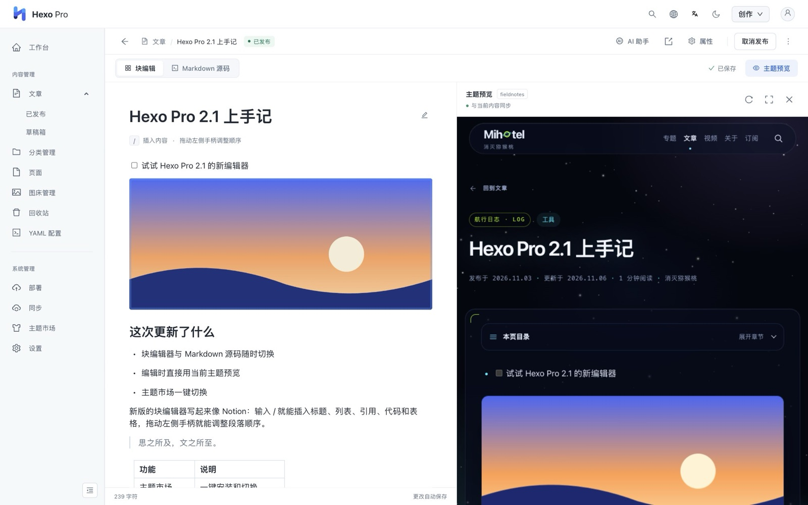
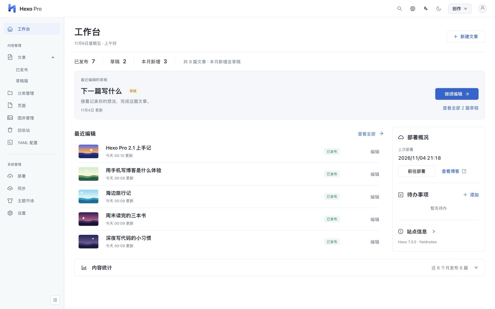
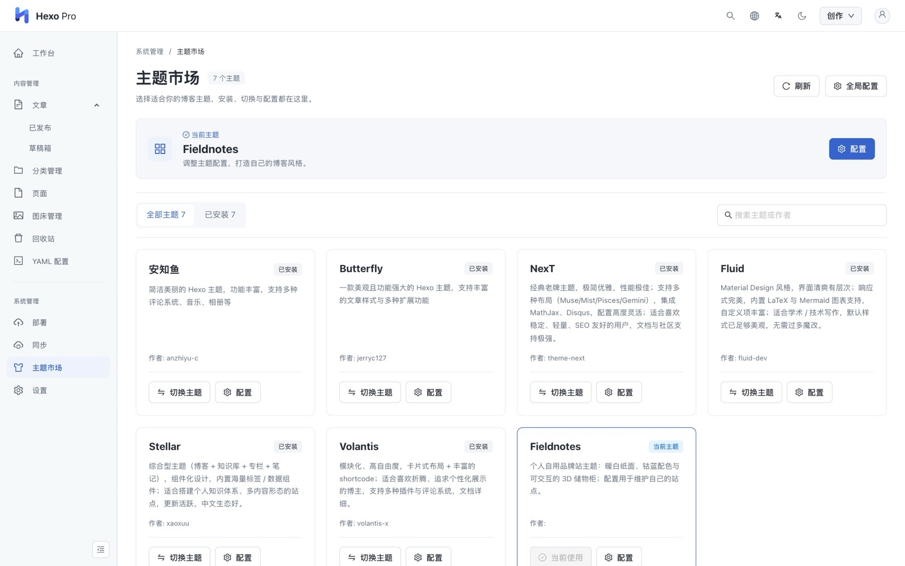
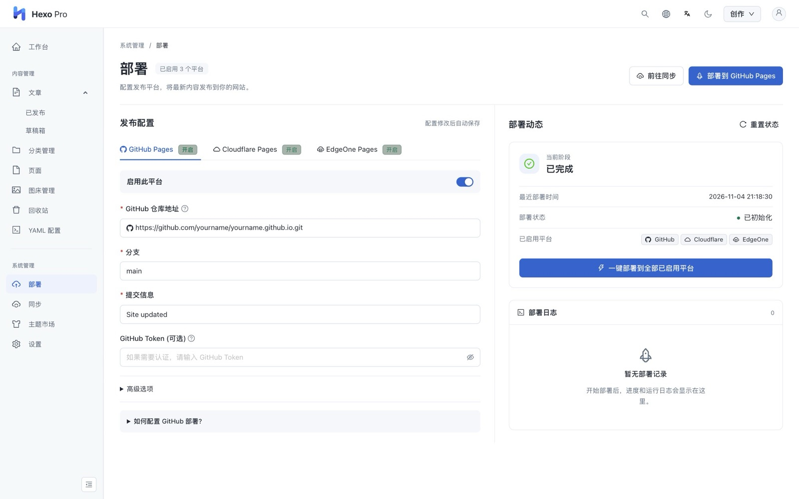
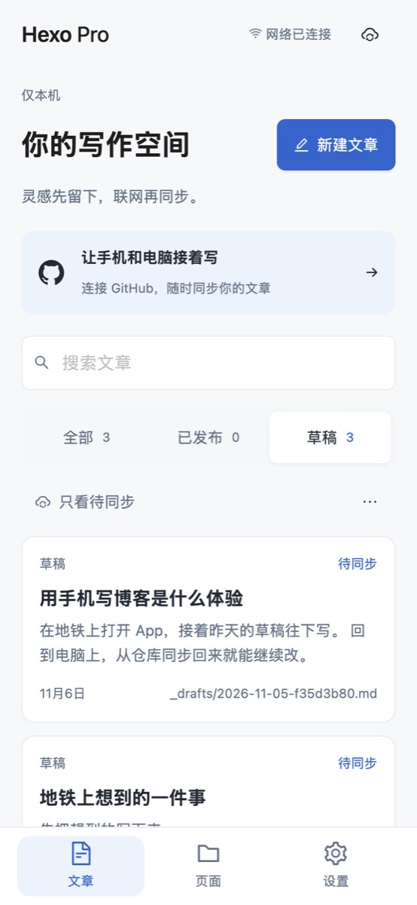

<p align="center">
  
</p>

<p align="center">
  <strong>给 Hexo 博客配一个可视化后台。</strong><br>
  在界面里写文章、换主题、传图片、发布网站，不用记命令。
</p>

<p align="center">
  <a href="https://github.com/heywarms/hexo-pro/releases/latest"></a>
  <a href="https://github.com/heywarms/hexo-pro/releases"></a>
  <a href="https://github.com/heywarms/hexo-pro"></a>
  <a href="https://www.npmjs.com/package/hexo-pro"></a>
  <a href="./LICENSE"></a>
</p>

<p align="center">
  <a href="#快速开始">快速开始</a> ·
  <a href="#界面预览">界面预览</a> ·
  <a href="#常见问题">常见问题</a> ·
  <a href="./README_en.md">English</a>
</p>

## 能帮你做什么

Hexo 很好用，但写文章、改配置、部署要在文件和命令行之间来回切换。Hexo Pro 把这些事放进同一个界面，文章仍然是你博客里的 Markdown 文件。

| 想做的事 | Hexo Pro 怎么帮你 |
| --- | --- |
| **写文章** | 类似 Notion 的块编辑器，输入 `/` 就能插入标题、表格和图片，也可以随时切到 Markdown 源码。内容会自动保存。 |
| **看效果** | 边写边预览文章在当前主题里的样子，不用先生成网站。 |
| **换主题** | 内置安知鱼、Butterfly、NexT、Fluid、Stellar 和 Volantis，在界面里安装、切换和修改配置。 |
| **管图片** | 粘贴就能上传，可以存在本地，也可以存到阿里云 OSS、七牛云或腾讯云 COS。 |
| **发布网站** | 一键部署到 GitHub Pages、Cloudflare Pages 或 EdgeOne Pages。 |
| **在手机上写** | Android / iOS App 没网也能写，通过 GitHub 和电脑同步。两边改了同一篇文章时，由你决定保留哪个版本。 |
| **让 AI 帮忙** | 连上你自己的 AI 接口，写作时可以用 AI 助手；也支持 MCP，让 Agent 帮你查文章、写草稿、发布和部署。 |

另外还有全局搜索、回收站、YAML 配置编辑、深色模式和中英文界面。桌面 App 还能切换多个博客并自动更新。

> **2.1 目前是测试版。** 块编辑器、主题预览、手机 App、GitHub 同步、MCP 和桌面自动更新都是 2.1 才有的功能。想要更稳妥，可以用正式版 2.0.0。升级前请先备份博客源文件。

## 快速开始

| 你的情况 | 选这个 |
| --- | --- |
| 不想装 Node.js，下载就能用；还没有博客也可以 | [桌面 App](#桌面-app) |
| 已经有 Hexo 博客，习惯用命令行 | [Hexo 插件](#hexo-插件) |
| 想在手机上写文章 | [手机 App](#手机-app) |

### 桌面 App

安装包自带 Node.js、npm 和 Git，不需要提前安装。支持 Windows 10+、macOS 12+ 和 Ubuntu 22.04+。

1. 下载对应系统的 2.1.0 Beta 3 安装包：

   | 系统 | 下载 |
   | --- | --- |
   | Mac（Apple 芯片） | [DMG](https://github.com/heywarms/hexo-pro/releases/download/v2.1.0-beta.3/Hexo-Pro-Desktop-2.1.0-beta.3-mac-arm64.dmg) |
   | Mac（Intel 芯片） | [DMG](https://github.com/heywarms/hexo-pro/releases/download/v2.1.0-beta.3/Hexo-Pro-Desktop-2.1.0-beta.3-mac-x64.dmg) |
   | Windows（x64） | [EXE](https://github.com/heywarms/hexo-pro/releases/download/v2.1.0-beta.3/Hexo-Pro-Desktop-2.1.0-beta.3-win-x64.exe) |
   | Linux（x64） | [AppImage](https://github.com/heywarms/hexo-pro/releases/download/v2.1.0-beta.3/Hexo-Pro-Desktop-2.1.0-beta.3-linux-x86_64.AppImage) |

2. 打开 App，选择已有的博客文件夹，或者新建一个博客。
3. 开始写作，写完后在「部署」页面发布。

系统提示无法打开？看[常见问题](#常见问题)。想用正式版，可以到 [2.0.0 下载页](https://github.com/heywarms/hexo-pro/releases/tag/v2.0.0)。

### Hexo 插件

需要 Node.js 20.19 或更新版本，以及 Hexo 8。在博客目录里安装：

```bash
npm install --save https://github.com/heywarms/hexo-pro/releases/download/v2.1.0-beta.3/hexo-pro-2.1.0-beta.3.tgz
```

启动博客：

```bash
npx hexo server
```

然后用浏览器打开 <http://localhost:4000/pro/>。第一次进入时可以设置账号密码，也可以之后再设置。

想用正式版 2.0.0，安装命令换成：

```bash
npm install --save hexo-pro
```

> **注意：** 2.1 的后续测试版只发布在 GitHub。npm 的 `beta` 标签还停留在 2.1.0-beta.0，`npm install hexo-pro@beta` 装到的是旧版本，请用上面的地址安装。

### 手机 App

手机写作不需要电脑开着，也不需要服务器。文章保存在手机上，通过你自己的 GitHub 仓库同步。

- **Android 7+**：下载[测试版 APK](https://github.com/heywarms/hexo-pro/releases/download/v2.1.0-beta.3/HexoPro-2.1.0-beta.3-android-debug.apk)。这是测试签名的安装包，还没有上架应用商店。
- **iPhone（iOS 16.4+）**：还没有上架 App Store 或 TestFlight。发布页的安装包只能装到已登记的测试设备上，其他设备需要用 Xcode 自行构建。

连接 GitHub 和构建步骤见[手机 App 指南](https://github.com/heywarms/hexo-pro-client/blob/master/docs/MOBILE_APP.md)。

## 界面预览

<p align="center">
  <br>
  <sub>一边写，一边看文章在当前主题里的样子</sub>
</p>

<table>
  <tr>
    <td width="50%"></td>
    <td width="50%"></td>
  </tr>
  <tr>
    <td align="center"><sub>工作台：最近编辑、草稿和部署情况</sub></td>
    <td align="center"><sub>主题市场：安装、切换和配置主题</sub></td>
  </tr>
  <tr>
    <td width="50%"></td>
    <td width="50%" align="center"></td>
  </tr>
  <tr>
    <td align="center"><sub>部署：GitHub Pages、Cloudflare Pages 和 EdgeOne Pages</sub></td>
    <td align="center"><sub>手机 App：离线写作，通过 GitHub 同步</sub></td>
  </tr>
</table>

## 常见问题

**我的文章会被改成别的格式吗？**

不会。文章还是 Hexo 的 Markdown 文件和 Front Matter，放在原来的位置。后台账号、设置等数据放在博客目录的 `data/` 和 `.hexo-pro/` 里。

**后台会被发布到网站上吗？**

不会。后台只在 `hexo server` 或桌面 App 运行时出现，`hexo generate` 生成的静态网站里没有它。如果你在公网服务器上运行 `hexo server`，请务必设置账号密码。

**系统提示无法打开 App 怎么办？**

测试版的 Mac 安装包已签名但还没有经过 Apple 公证，Windows 安装包没有代码签名，所以系统可能会拦截。

- **Mac**：到「系统设置 → 隐私与安全性」，点「仍要打开」。
- **Windows**：在 SmartScreen 提示里点「更多信息」，再点「仍要运行」。
- **Linux**：先运行 `chmod +x` 给 AppImage 加上执行权限，再打开。

**桌面 App 怎么更新？**

从 2.1.0 Beta 2 开始支持自动更新。App 在后台下载新版本，你确认后重启安装；也可以在「设置 → 帮助与更新」里关闭自动下载。更早的版本需要手动安装新版。

**插件怎么换回正式版？**

在博客目录运行 `npm install --save hexo-pro@2.0.0`。换版本前同样建议先备份。

**遇到问题找谁？**

到 [GitHub Issues](https://github.com/heywarms/hexo-pro/issues) 提问题，或者加 QQ 群 1009585669。

## 更多文档

- [手机 App 指南](https://github.com/heywarms/hexo-pro-client/blob/master/docs/MOBILE_APP.md)
- [云同步与源码上传](https://github.com/heywarms/hexo-pro-client/blob/master/docs/SOURCE_SYNC.md)
- [编辑器说明](https://github.com/heywarms/hexo-pro-client/blob/master/docs/EDITOR.md)
- [Agent / MCP 接入](https://github.com/heywarms/hexo-pro-client/blob/master/docs/HERMES_AGENT_INTEGRATION.md)（英文）
- [桌面端自动更新](https://github.com/heywarms/hexo-pro-desktop/blob/master/docs/AUTO_UPDATE.md)

## 更新日志

完整说明和各版本下载见 [Releases](https://github.com/heywarms/hexo-pro/releases)。

**2.1.0 Beta 3（2026-11-07）**

- 修复 Volantis 安装失败和 Stellar 切换失败。
- 修复装了插件后 `hexo clean` 不生效、换主题后混入旧主题资源的问题。
- 修复部分主题预览空白、表格单元格换行和找回密码的问题。

**2.1.0 Beta 2（2026-10-16）**

- 桌面端内置 Node.js、npm、Git 和博客模板，并新增自动更新。
- 统一浅色和深色界面，改进块编辑器和 GitHub 同步。

**2.1.0 Beta 1（2026-10-15）**

- 重新整理工作台、文章列表、编辑器和各设置页面。
- 编辑器支持直接粘贴图片和调整图片宽度。

**2.1.0 Beta（2026-10-13）**

- 新增块编辑器、主题预览、GitHub 同步、手机 App 和 MCP。

<details>
<summary>更早的版本</summary>

**2.0.0（2026-03-17）**

- 核心版本升级到 `2.0.0`，与客户端、桌面端的版本策略对齐。
- 统一并锁定 `cheerio` 版本为 `1.0.0-rc.12`，避免发布时出现 `EOVERRIDE` 冲突。
- 从 `1.x` 升级后，建议重新安装依赖再启动。

**1.2.6（2025-06-15）**

- 修复 Front Matter 中布尔值的展示和设置问题。
- 桌面端可自动加载项目 `node_modules` 中的 Hexo 插件。
- 桌面端跳转链接默认指向 `localhost:4000`，也可以自定义。
- 新增编辑器默认模式、封面隐藏和跳过静态文件生成的部署选项。

**1.2.4（2025-06-07）**

- 新增桌面端子项目，支持多项目管理。
- 优化核心 API 结构，改善桌面端和 Web 端的协同。

**1.2.0（2025-05-10）**

- 新增图床管理、YAML 配置管理、设置和主页功能。

**1.1.16（2024-08-29）**

- 优化编辑器体验，改进深色模式，增强全局搜索。

</details>

## 参与和支持

欢迎提交 [Issue](https://github.com/heywarms/hexo-pro/issues) 和 Pull Request，也欢迎加入 QQ 群交流。

<p align="center">
  <br>
  <sub>QQ 群：1009585669</sub>
</p>

如果这个项目帮到了你，可以点个 Star，或者请作者喝杯咖啡。

<p align="center">
  
  
</p>

感谢以下捐助者，排名不分先后。想出现在这里，打赏后联系我们添加头像。

<table align="center">
  <tr>
    <td align="center">
      <br>
      <sub><b>v快</b></sub>
    </td>
    <td align="center">
      <br>
      <sub><b>神秘支持者</b></sub>
    </td>
    <td align="center">
      <br>
      <sub><b>Crosery</b></sub>
    </td>
  </tr>
</table>

## 给开发者

Hexo Pro 由三个仓库组成：

| 仓库 | 内容 | 技术 |
| --- | --- | --- |
| [hexo-pro](https://github.com/heywarms/hexo-pro)（本仓库） | Hexo 插件、后台接口、Agent 和 MCP 命令 | Node.js、Express、NeDB |
| [hexo-pro-client](https://github.com/heywarms/hexo-pro-client) | 网页界面和手机 App，也是开发主仓库 | React、TypeScript、Capacitor |
| [hexo-pro-desktop](https://github.com/heywarms/hexo-pro-desktop) | 桌面客户端 | Electron |

## 许可证

[MIT](./LICENSE) © wuzheng
