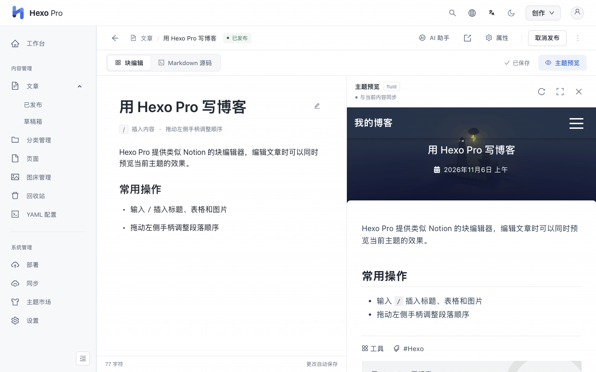
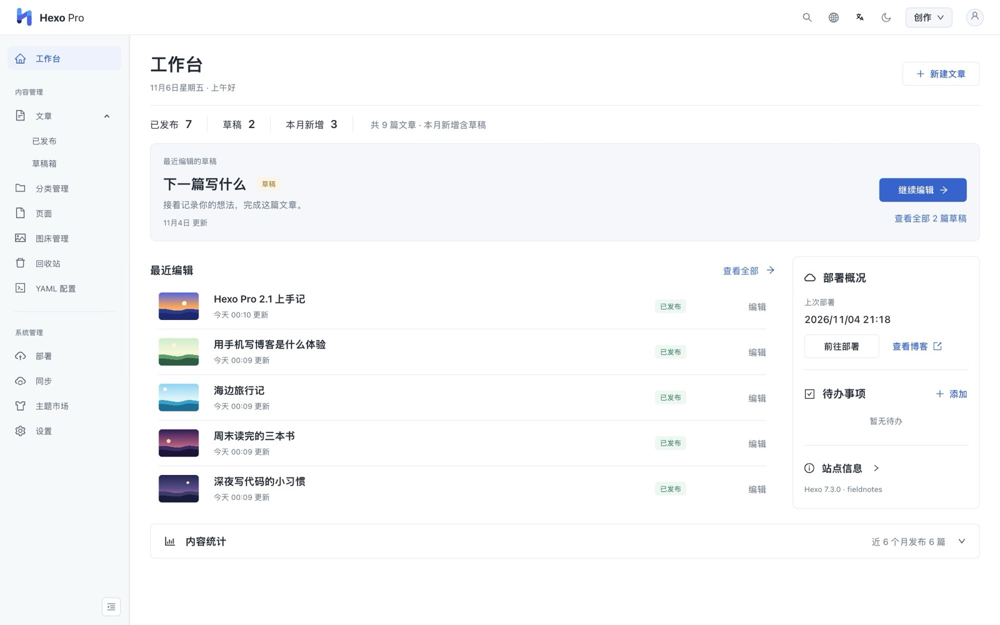
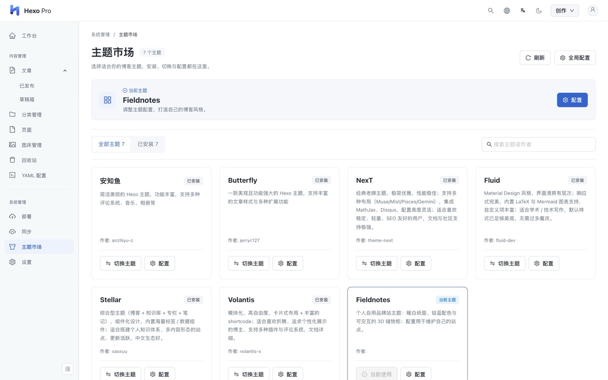
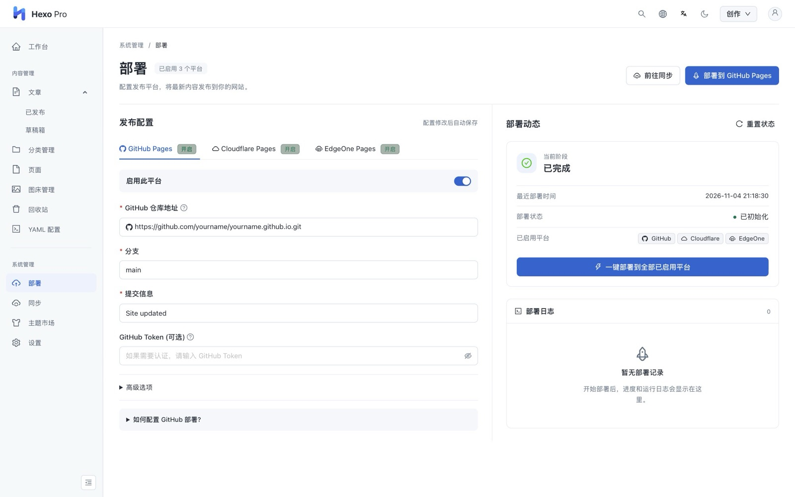
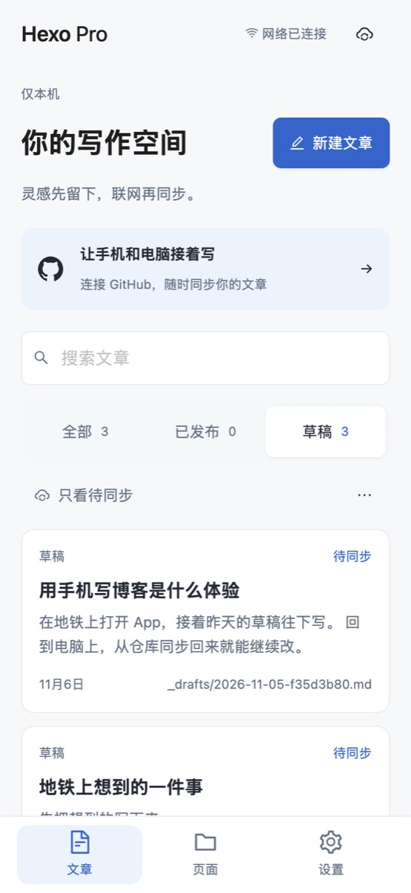

<p align="center">
  
</p>

<p align="center">
  <strong>Hexo Pro, a visual admin panel for Hexo blogs</strong><br>
  Post editing, theme preview and switching, image management, and one-click deployment.
</p>

<p align="center">
  <a href="https://github.com/heywarms/hexo-pro/releases/latest"></a>
  <a href="https://github.com/heywarms/hexo-pro/releases"></a>
  <a href="https://github.com/heywarms/hexo-pro"></a>
  <a href="https://www.npmjs.com/package/hexo-pro"></a>
  <a href="./LICENSE"></a>
</p>

<p align="center">
  <a href="#quick-start">Quick start</a> ·
  <a href="#screenshots">Screenshots</a> ·
  <a href="#faq">FAQ</a> ·
  <a href="./README.md">中文</a>
</p>

## Features

Hexo Pro is a visual management tool for Hexo. Post editing, theme configuration and site deployment all happen in its interface. Posts stay in the blog folder as Markdown files.

<p align="center">
  
</p>

| Feature | Description |
| --- | --- |
| **Post editing** | A Notion-style block editor. Type `/` to insert headings, tables and images, or switch to Markdown source. Changes save automatically. |
| **Theme preview** | Preview the current theme while editing a post, without generating the site first. |
| **Theme management** | AnZhiYu, Butterfly, NexT, Fluid, Stellar and Volantis are built in, with install, switch and configuration from the interface. |
| **Image management** | Paste to upload. Images can be stored locally or on Aliyun OSS, Qiniu Cloud or Tencent COS. |
| **Site deployment** | One-click deployment to GitHub Pages, Cloudflare Pages and EdgeOne Pages. |
| **Mobile writing** | Android and iOS apps with offline writing and GitHub sync. If a post changes on both sides, you choose which version to keep. |
| **AI and MCP** | Connect your own AI service to use the writing assistant. With MCP, agents can search posts, write drafts, publish and deploy. |

Also includes global search, a recycle bin, a YAML config editor, dark mode, and English and Chinese interfaces. The desktop app can switch between blogs and update automatically.

> **2.1 is in beta.** The block editor, theme preview, mobile apps, GitHub sync, MCP and desktop auto-update are new in 2.1 and aren't in stable 2.0.0. Back up your blog source before upgrading.

## Quick start

| Situation | Recommended |
| --- | --- |
| Node.js not installed, or no blog yet | [Desktop app](#desktop-app) |
| Existing Hexo blog, familiar with the command line | [Hexo plugin](#hexo-plugin) |
| Writing on a phone | [Mobile app](#mobile-app) |

### Desktop app

Node.js, npm and Git are bundled with the installer. Supports Windows 10+, macOS 12+ and Ubuntu 22.04+.

1. Download 2.1.0 Beta 3 for your system:

   | System | Download |
   | --- | --- |
   | Mac (Apple silicon) | [DMG](https://github.com/heywarms/hexo-pro/releases/download/v2.1.0-beta.3/Hexo-Pro-Desktop-2.1.0-beta.3-mac-arm64.dmg) |
   | Mac (Intel) | [DMG](https://github.com/heywarms/hexo-pro/releases/download/v2.1.0-beta.3/Hexo-Pro-Desktop-2.1.0-beta.3-mac-x64.dmg) |
   | Windows (x64) | [EXE](https://github.com/heywarms/hexo-pro/releases/download/v2.1.0-beta.3/Hexo-Pro-Desktop-2.1.0-beta.3-win-x64.exe) |
   | Linux (x64) | [AppImage](https://github.com/heywarms/hexo-pro/releases/download/v2.1.0-beta.3/Hexo-Pro-Desktop-2.1.0-beta.3-linux-x86_64.AppImage) |

2. Open the app, then choose an existing blog folder or create a new blog.
3. Edit your posts, then publish from the Deploy page.

If the system won't open the app, see the [FAQ](#faq). The stable version is on the [2.0.0 release page](https://github.com/heywarms/hexo-pro/releases/tag/v2.0.0).

### Hexo plugin

Requires Node.js 20.19 or newer and Hexo 8. Install it in your blog folder:

```bash
npm install --save https://github.com/heywarms/hexo-pro/releases/download/v2.1.0-beta.3/hexo-pro-2.1.0-beta.3.tgz
```

Start the blog:

```bash
npx hexo server
```

Then open <http://localhost:4000/pro/> in a browser. On first use, you can set a username and password or do it later.

To install stable 2.0.0:

```bash
npm install --save hexo-pro
```

> **Note:** Later 2.1 betas are published only on GitHub. The npm `beta` tag still points to 2.1.0-beta.0, so `npm install hexo-pro@beta` installs an older version. Use the address above instead.

### Mobile app

The mobile app doesn't depend on a computer or server. Posts are saved on the phone and sync through your own GitHub repository.

- **Android 7+**: download the [test APK](https://github.com/heywarms/hexo-pro/releases/download/v2.1.0-beta.3/HexoPro-2.1.0-beta.3-android-debug.apk). It's signed for testing and isn't in an app store.
- **iPhone (iOS 16.4+)**: not on the App Store or TestFlight yet. The package on the release page only installs on registered test devices. Other devices need their own build from Xcode.

For GitHub setup and build steps, see the [mobile app guide](https://github.com/heywarms/hexo-pro-client/blob/master/docs/MOBILE_APP.md) (in Chinese).

## Screenshots

The demo and screenshots show the Chinese interface. You can switch to English from the top bar.

<table>
  <tr>
    <td width="50%"></td>
    <td width="50%"></td>
  </tr>
  <tr>
    <td align="center"><sub>Dashboard: recent edits, drafts and deployment status</sub></td>
    <td align="center"><sub>Theme market: install, switch and configure themes</sub></td>
  </tr>
  <tr>
    <td width="50%"></td>
    <td width="50%" align="center"></td>
  </tr>
  <tr>
    <td align="center"><sub>Deploy: GitHub Pages, Cloudflare Pages and EdgeOne Pages</sub></td>
    <td align="center"><sub>Mobile app: offline writing and GitHub sync</sub></td>
  </tr>
</table>

## FAQ

**Will posts be converted to another format?**

No. Posts stay as Hexo Markdown files with Front Matter, in the same location. Admin accounts, settings and similar data are stored in the `data/` and `.hexo-pro/` folders of the blog.

**Will the admin panel be published with the site?**

No. It's only available while `hexo server` or the desktop app is running, and the static site from `hexo generate` doesn't include it. If you run `hexo server` on a public server, make sure to set a username and password.

**What if the system won't open the app?**

The beta Mac packages are signed but not yet notarized by Apple, and the Windows installer has no code signature, so the system may block them.

- **Mac**: go to System Settings → Privacy & Security and click Open Anyway.
- **Windows**: in the SmartScreen prompt, click More info, then Run anyway.
- **Linux**: run `chmod +x` on the AppImage to make it executable, then open it.

**How does the desktop app update?**

Auto-update is available from 2.1.0 Beta 2. The app downloads new versions in the background and installs them after you confirm a restart. Automatic downloads can be turned off under Settings → Help & Updates. Older versions need a manual install.

**How do I switch the plugin back to stable?**

Run `npm install --save hexo-pro@2.0.0` in the blog folder. Back up before changing versions.

**How do I report a problem?**

Open a [GitHub issue](https://github.com/heywarms/hexo-pro/issues) or join QQ group 1009585669.

## More docs

- [Mobile app guide](https://github.com/heywarms/hexo-pro-client/blob/master/docs/MOBILE_APP.md) (Chinese)
- [Cloud sync and source upload](https://github.com/heywarms/hexo-pro-client/blob/master/docs/SOURCE_SYNC.md) (Chinese)
- [Editor guide](https://github.com/heywarms/hexo-pro-client/blob/master/docs/EDITOR.md) (Chinese)
- [Agent and MCP integration](https://github.com/heywarms/hexo-pro-client/blob/master/docs/HERMES_AGENT_INTEGRATION.md)
- [Desktop auto-update](https://github.com/heywarms/hexo-pro-desktop/blob/master/docs/AUTO_UPDATE.md) (Chinese)

## Changelog

Full notes and downloads for every version are on the [Releases](https://github.com/heywarms/hexo-pro/releases) page.

**2.1.0 Beta 3 (2026-11-07)**

- Fixed Volantis installation and Stellar switching failures.
- Fixed `hexo clean` not working with the plugin installed, which mixed old theme assets into the site after a theme change.
- Fixed blank previews in some themes, line breaks in table cells, and password recovery.

**2.1.0 Beta 2 (2026-10-16)**

- The desktop app now bundles Node.js, npm, Git and a blog template, and gains auto-update.
- Unified the light and dark interfaces and improved the block editor and GitHub sync.

**2.1.0 Beta 1 (2026-10-15)**

- Reworked the dashboard, post list, editor and settings pages.
- The editor can now paste images directly and resize them.

**2.1.0 Beta (2026-10-13)**

- Added the block editor, theme preview, GitHub sync, mobile apps and MCP.

<details>
<summary>Earlier versions</summary>

**2.0.0 (2026-03-17)**

- Moved the core to `2.0.0`, in line with the client and desktop versions.
- Pinned `cheerio` to `1.0.0-rc.12` to avoid `EOVERRIDE` conflicts when publishing.
- After upgrading from `1.x`, reinstall dependencies before starting.

**1.2.6 (2025-06-15)**

- Fixed how Front Matter Boolean values are displayed and set.
- The desktop app can load Hexo plugins from a project's `node_modules` automatically.
- Desktop links point to `localhost:4000` by default and can be customized.
- Added options for the default editor mode, hiding covers, and skipping static file generation when deploying.

**1.2.4 (2025-06-07)**

- Added the desktop sub-project with multi-project management.
- Improved the core API structure for desktop and web.

**1.2.0 (2025-05-10)**

- Added image hosting, YAML config management, settings and a home page.

**1.1.16 (2024-08-29)**

- Improved the editor, dark mode and global search.

</details>

## Contribute

Issues and pull requests are welcome on [GitHub](https://github.com/heywarms/hexo-pro/issues). There's also a Chinese-language QQ group.

<p align="center">
  <br>
  <sub>QQ group: 1009585669</sub>
</p>

## Donate

If you find this project helpful, a small gesture like buying a cup of coffee ☕️ helps us keep improving it.

<p align="center">
  
  
</p>

Thanks to the following supporters, in no particular order. Your donations keep development going!

<table align="center">
  <tr>
    <td align="center">
      <br>
      <sub><b>v快</b></sub>
    </td>
    <td align="center">
      <br>
      <sub><b>神秘支持者</b></sub>
    </td>
    <td align="center">
      <br>
      <sub><b>Crosery</b></sub>
    </td>
  </tr>
</table>

Want to be a donor? Scan the QR code above to support the project, and contact us to add your avatar.

## Project structure

Hexo Pro is made up of three repositories:

| Repository | Contents | Built with |
| --- | --- | --- |
| [hexo-pro](https://github.com/heywarms/hexo-pro) (this one) | Hexo plugin, admin API, agent and MCP commands | Node.js, Express, NeDB |
| [hexo-pro-client](https://github.com/heywarms/hexo-pro-client) | Web interface and mobile apps; also the main development repository | React, TypeScript, Capacitor |
| [hexo-pro-desktop](https://github.com/heywarms/hexo-pro-desktop) | Desktop client | Electron |

## License

[MIT](./LICENSE) © [heywarms](https://github.com/heywarms)
